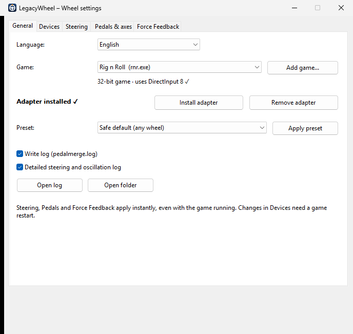
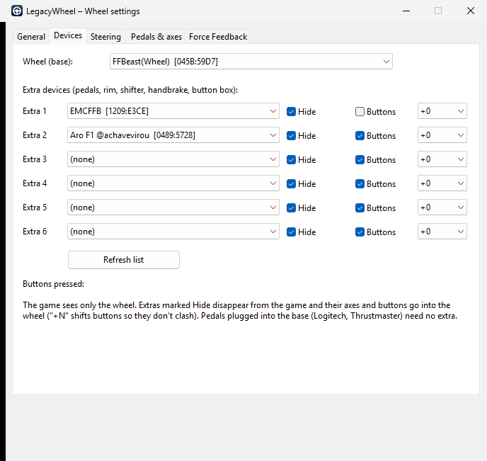
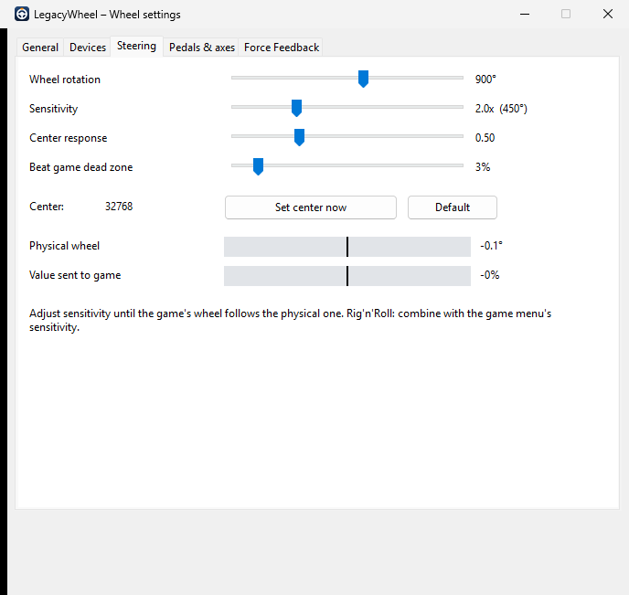
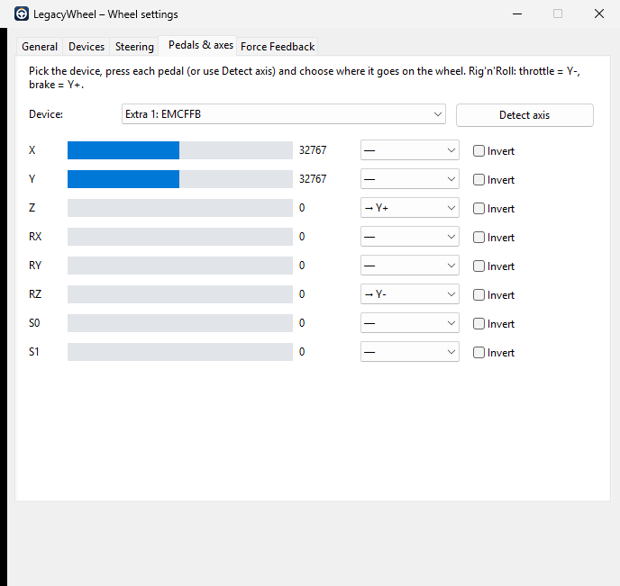
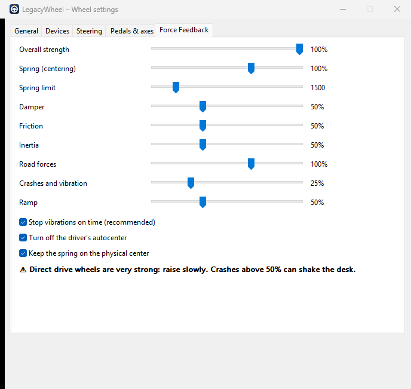

<p align="center">
  
</p>

<h1 align="center">LegacyWheel</h1>

<p align="center">
  <b>Use your modern wheel, separate pedals and button rim in old DirectInput games, with safe force feedback.</b><br>
  <a href="README.pt-BR.md">Leia em Português</a>
</p>

---

Many older racing and truck games accept **only one controller** and send force feedback values that
modern direct drive wheels take literally. LegacyWheel is a small drop-in adapter (`dinput.dll` /
`dinput8.dll`) plus a settings app with sliders. It:

- **Merges devices.** Pedals, button rims, shifters, handbrakes and button boxes on separate USB ports
  are hidden from the game and their axes and buttons are injected into the wheel. The game sees one
  controller with everything on it.
- **Makes force feedback safe.** Invalid effect values are fixed and clamped. Vibrations are stopped on
  time even if the wheel firmware ignores the effect duration. The centering spring has a ceiling.
- **Tunes steering.** Sensitivity, center response curve, dead zone compensation and center offset.
- **Applies changes live.** Move a slider while driving and the game picks it up within a second.

It was born to make a DIY hoverboard direct drive wheel (FFBeast firmware) work in **Rig'n'Roll**,
and it works with any wheel that Windows sees as a game controller.

## Screenshots

| General | Devices | Steering |
|---|---|---|
|  |  |  |

| Pedals & axes | Force Feedback |
|---|---|
|  |  |

## Quick start

1. Download the latest release and extract it anywhere. Keep `LegacyWheel.exe` next to the `x86` and `x64` folders.
2. Run `LegacyWheel.exe`. Steam's Rig'n'Roll is found automatically; for other games click **Add game...** and pick the game's `.exe`.
   The app shows whether the game is 32- or 64-bit and whether it uses DirectInput.
3. Click **Install adapter**.
4. **Devices** tab: choose your wheel base and up to 6 extra devices. Tick **Hide** so the game doesn't see them separately.
5. **Pedals & axes** tab: click **Detect axis**, press a pedal all the way and release, then choose which wheel axis it becomes.
6. **General** tab: pick a preset and click **Apply preset**.
7. Start the game and fine-tune Steering, Pedals and Force Feedback while driving.

To uninstall, click **Remove adapter**. If another mod's DLL was there before, it is restored.

## Compatibility

| Game | Works? |
|---|---|
| Old game, DirectInput, accepts only one controller (e.g. Rig'n'Roll) | ✅ Main use case: merging + safe FFB |
| Old game that already supports several controllers | ✅ Merging not needed, but FFB safety and sliders still help |
| 64-bit DirectInput game | ✅ The 64-bit adapter is included |
| Game that uses only XInput, SDL or Steam Input | ❌ The game never goes through DirectInput |
| Online game with anti-cheat (EasyAntiCheat, BattlEye...) | ⛔ Don't use it there: a foreign `dinput8.dll` may be flagged |

Wheels: anything that Windows lists as a game controller, including Logitech, Thrustmaster, Fanatec,
Moza, Simucube and DIY boards (FFBeast, OpenFFBoard...).
If your pedals plug into the wheel base (Logitech G29/G920, Thrustmaster T-series), they already
come in as one device and no extra device is needed.

**Tested so far:** Rig'n'Roll with an FFBeast hoverboard direct drive, EMCFFB pedals and a separate USB
button rim. Reports for other games and wheels are very welcome. Please open an issue.

## Safety

Direct drive wheels can produce dangerous torque. The defaults are conservative. Raise
**Crashes and vibration** and **Spring** slowly, and keep your hands on the wheel the first time
you try a new game. The adapter clamps every effect, but your wheel software's own limits still
come first.

## How it works

Windows games load `dinput.dll` / `dinput8.dll` from their own folder before the system copy.
The adapter is a proxy with the same name: it loads the real DirectInput from `System32`, forwards
everything, and hooks only a few points.

- **Enumeration:** extra devices marked *Hide* are removed from the list the game sees.
- **`GetDeviceState`:** when the game reads the wheel, the axes and buttons of the extra devices are
  written into it, mapped by `pedalmerge.ini`.
- **`CreateEffect` / `SetParameters` / `Start`:** effects are scaled, clamped and fixed. A timer
  stops effects at the end of their duration.

All settings live in `pedalmerge.ini` in the game folder. The settings app writes it atomically and
the adapter re-reads it within a second, so tuning works with the game running. Nothing is
installed system-wide, and other games are not affected.

<details>
<summary><b>pedalmerge.ini reference</b></summary>

```ini
[devices]
wheel=045B:59D7          ; VID:PID of the wheel base

[src1]                   ; extra devices: [src1] .. [src6]
device=1209:E3CE         ; VID:PID
hide=1                   ; 1 = hide from the game
buttons=0                ; 1 = add its buttons to the wheel's
button_offset=0          ; button N -> wheel button N + offset
RZ=Y-                    ; source axis = wheel axis. "Y" full axis,
Z=Y+                     ; "Y+" center->max, "Y-" center->min (half axes)
invert_Z=0

[steering]
center=32768             ; raw X value with the wheel straight
rotation=900             ; degrees set in the wheel software
gain=1.0                 ; sensitivity (2.0 = half the rotation in game)
curve=1.00               ; < 1 = livelier near center
deadzone=0               ; % jump to beat the game's own dead zone

[ffb]                    ; percent per effect type
gain=100
spring=100
spring_gain_max=1500     ; ceiling for the spring effect gain (0..10000)
damper=50
friction=50
inertia=50
constant=100
periodic=25              ; crashes / curbs / vibration
ramp=50
spring_offset_zero=1
autocenter_off=1
enforce_duration=1       ; stop effects on time even if the firmware doesn't

[options]
log=1                    ; write pedalmerge.log
log_steering=0           ; detailed steering/oscillation log
```
</details>

## Building from source

You only need [Zig](https://ziglang.org) (no Visual Studio): `winget install zig.zig`, then run `build.cmd`.

It builds the 32- and 64-bit adapters, the settings app, and runs the unit tests. The output goes to `dist\`.

```
src/        adapter (pedalmerge.c), settings app (legacywheel.c), .def/.rc/.manifest/.ico
tests/      ffbtest.c (FFB fixes, auto-stop, oscillation detector), mergetest.c (acts as a game)
tools/      make_icon.py, axismon.c, wobble.c, ffbreset.c (diagnostics)
```

## License

[MIT](LICENSE)
