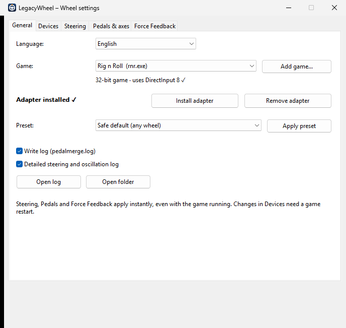
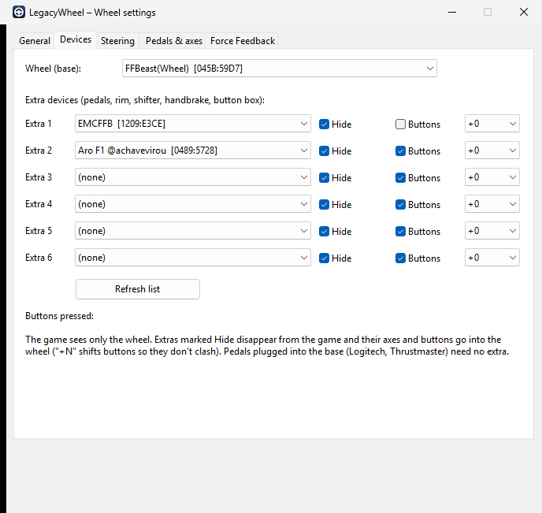
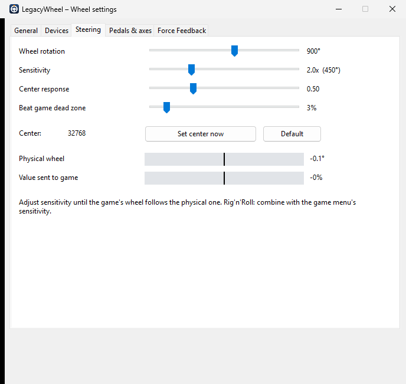
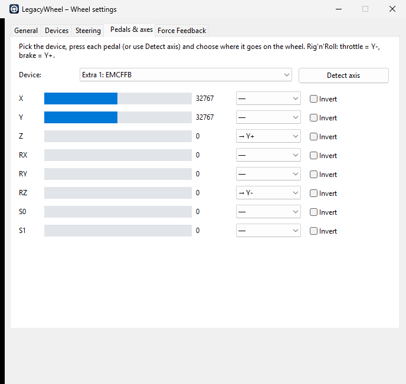
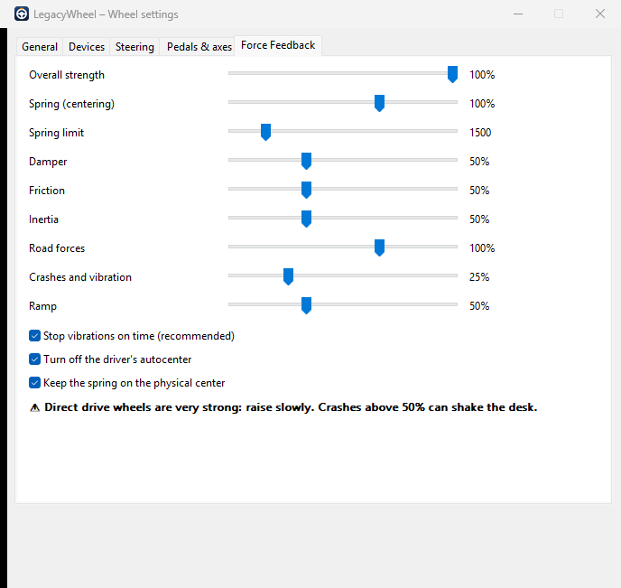

  

<h1 align="center">LegacyWheel</h1>

  <b>Use seu volante moderno, pedais separados e aro com botões em jogos antigos com DirectInput, com force feedback seguro.</b> 
  <a href="README.md">Read in English</a>

---

Muitos jogos antigos de corrida e de caminhão aceitam **um só controle** e mandam valores de force
feedback que volantes direct drive modernos levam ao pé da letra. O LegacyWheel é um adaptador que
se coloca na pasta do jogo (`dinput.dll` / `dinput8.dll`), mais um programa de ajustes com barras
deslizantes. Ele:

- **Junta dispositivos.** Pedais, aro com botões, câmbio, freio de mão e button box ligados em USBs
  separados somem da lista do jogo, e seus eixos e botões entram no volante. O jogo enxerga um único
  controle com tudo.
- **Deixa o force feedback seguro.** Valores inválidos são corrigidos e limitados. As vibrações param
  no tempo certo mesmo se o firmware do volante ignorar a duração do efeito. A mola de centralização
  tem um teto.
- **Ajusta a direção.** Sensibilidade, curva de resposta no centro, compensação de zona morta e correção
  do centro.
- **Aplica na hora.** Mova uma barra dirigindo e o jogo aplica em até 1 segundo.

Nasceu para fazer um volante direct drive DIY com motor de hoverboard (firmware FFBeast) funcionar no
**Rig'n'Roll**, e funciona com qualquer volante que o Windows reconheça como controle de jogo.

## Telas

As telas abaixo estão em inglês. O programa troca para português na aba General / Geral.

| Geral | Dispositivos | Direção |
|---|---|---|
|  |  |  |

| Pedais e eixos | Force Feedback |
|---|---|
|  |  |

## Como usar

1. Baixe a versão mais recente em *Releases* e extraia onde quiser. Mantenha o `LegacyWheel.exe` junto das pastas `x86` e `x64`.
2. Abra o `LegacyWheel.exe`. O Rig'n'Roll da Steam aparece sozinho; para outros jogos, clique em **Adicionar jogo...** e escolha o `.exe` do jogo.
   O programa mostra se o jogo é de 32 ou 64 bits e se usa DirectInput.
3. Clique em **Instalar adaptador**.
4. Aba **Dispositivos**: escolha a base do volante e até 6 dispositivos extras. Marque **Esconder** para o jogo não vê-los separados.
5. Aba **Pedais e eixos**: clique em **Detectar eixo**, pise no pedal até o fim, solte e escolha em qual eixo do volante ele entra.
6. Aba **Geral**: escolha um perfil pronto e clique em **Aplicar perfil**.
7. Abra o jogo e faça o ajuste fino de Direção, Pedais e Force Feedback dirigindo.

Para desinstalar, clique em **Remover adaptador**. Se havia a DLL de outro mod antes, ela é devolvida.

## Compatibilidade

| Jogo | Funciona? |
|---|---|
| Antigo, DirectInput, aceita um só controle (ex.: Rig'n'Roll) | ✅ Uso principal: junção + FFB seguro |
| Antigo que já aceita vários controles | ✅ Não precisa juntar, mas a proteção do FFB e as barras ajudam |
| Jogo de 64 bits com DirectInput | ✅ O adaptador de 64 bits está incluído |
| Jogo que usa só XInput, SDL ou Steam Input | ❌ O jogo não passa pelo DirectInput |
| Jogo online com anti-cheat (EasyAntiCheat, BattlEye...) | ⛔ Não use: uma `dinput8.dll` estranha pode ser acusada |

Volantes: qualquer um que o Windows liste como controle de jogo, incluindo Logitech, Thrustmaster,
Fanatec, Moza, Simucube e placas DIY (FFBeast, OpenFFBoard...).
Se os pedais ligam na base do volante (Logitech G29/G920, Thrustmaster série T), eles já chegam como
um dispositivo só e não precisam de extra.

**Testado até agora:** Rig'n'Roll com direct drive de hoverboard (FFBeast), pedais EMCFFB e aro USB
separado. Relatos com outros jogos e volantes são muito bem-vindos. Abra uma *issue*.

## Segurança

Volantes direct drive podem gerar força perigosa. Os padrões são conservadores. Suba
**Batidas e vibrações** e **Mola** aos poucos, e fique com as mãos no volante na primeira vez que
testar um jogo novo. O adaptador limita todos os efeitos, mas os limites do software do seu volante
continuam valendo primeiro.

## Como funciona

Os jogos do Windows carregam `dinput.dll` / `dinput8.dll` da própria pasta antes da cópia do sistema.
O adaptador é um intermediário com o mesmo nome: ele carrega o DirectInput verdadeiro do `System32`,
repassa tudo e intercepta só alguns pontos.

- **Lista de controles:** os extras marcados com *Esconder* saem da lista que o jogo vê.
- **`GetDeviceState`:** quando o jogo lê o volante, os eixos e botões dos extras são escritos nele,
  conforme o `pedalmerge.ini`.
- **`CreateEffect` / `SetParameters` / `Start`:** os efeitos são escalados, limitados e corrigidos. Um
  temporizador para cada efeito no fim da duração.

Todos os ajustes ficam no `pedalmerge.ini`, na pasta do jogo. O programa grava o arquivo de uma vez só,
e o adaptador relê em até 1 segundo, por isso dá para ajustar com o jogo aberto. Nada é instalado no
Windows, e outros jogos não são afetados.

A referência completa do `pedalmerge.ini` está no [README em inglês](README.md#how-it-works).

## Compilar

Só precisa do [Zig](https://ziglang.org), sem Visual Studio: `winget install zig.zig`, depois rode `build.cmd`.

Ele gera os adaptadores de 32 e 64 bits e o programa de ajustes, e roda os testes. O resultado fica em `dist\`.

## Licença

[MIT](LICENSE)
